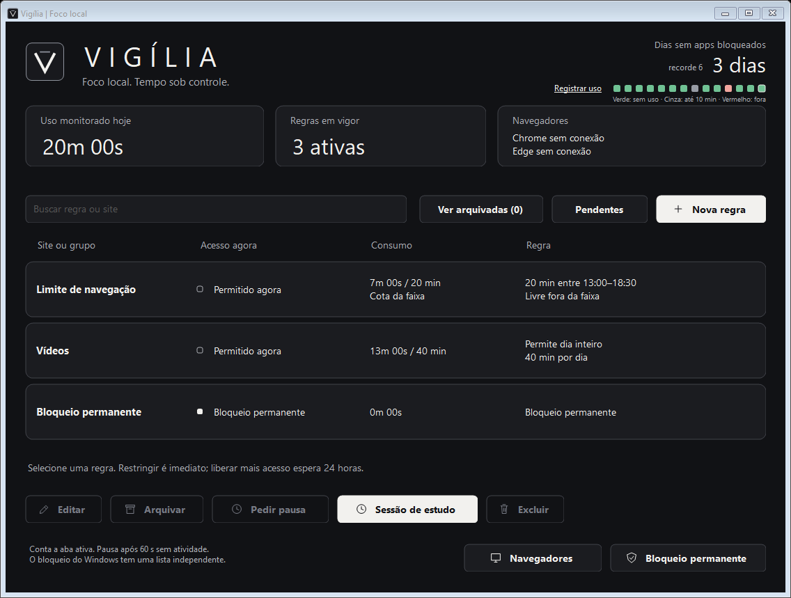
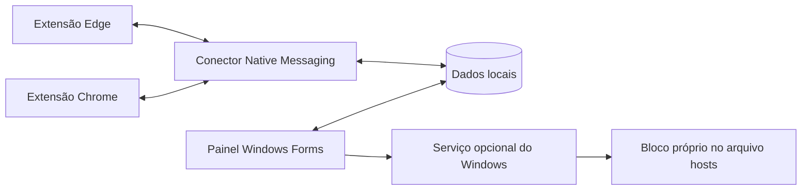

# Vigília

O Vigília cria uma barreira inicial mínima às distrações digitais: uma pequena pausa entre o impulso de abrir um site e a decisão de acessá-lo. O objetivo é aumentar a produtividade e o rendimento, além de ter mais tempo disponível para a vida real.

O projeto surgiu da inspiração em aplicações como o Cold Turkey e em extensões de bloqueio de sites. Ao explorar essas ferramentas, percebi algumas limitações em relação ao que buscava para minha rotina e decidi desenvolver uma solução personalizada, com regras e recursos que atendessem às minhas necessidades.

Você define os horários, as cotas de uso e os períodos de foco que fazem sentido para sua rotina em um painel no Windows. A extensão aplica os limites no Chrome e no Edge, contando o tempo na aba ativa com o navegador em primeiro plano.



A imagem usa dados de demonstração. O projeto está em fase de protótipo e a instalação é manual.

## O que ele faz

- Bloqueio permanente, horários de bloqueio e cotas de minutos por dia ou por faixa.
- Sessões de estudo com duração escolhida pelo usuário.
- Cota compartilhada entre Chrome e Edge.
- Arquivamento de regras sem perder a configuração.
- Espera de 24 horas para mudanças que liberam mais acesso. Restrições adicionais entram em vigor imediatamente.
- Pausa temporária em bloqueios permanentes: 30 minutos de espera, 10 minutos de acesso e intervalo de 24 horas por site/grupo, contado desde o início previsto da liberação anterior.
- Histórico de 14 dias: verde sem uso registrado, cinza dentro da pausa permitida e vermelho fora da regra. Uso no celular pode ser registrado manualmente.

O painel inclui uma reflexão opcional antes de pedir uma pausa. A conversa no ChatGPT é aberta somente por iniciativa do usuário, com texto copiado para colar manualmente. Não há API de IA nem envio automático. A conversa não autoriza desbloqueios.

## Como funciona



O painel e o conector são escritos em C# com .NET Framework 4.8. A extensão usa JavaScript e Manifest V3. PowerShell cuida da instalação, dos atalhos e do bloqueio permanente no Windows.

A lista de bloqueios do Windows é independente das cotas da extensão. Um site presente nas duas listas continua bloqueado pelo Windows mesmo com minutos disponíveis. O serviço opcional coordena a retirada e a restauração das entradas durante uma pausa solicitada.

## Instalar pelo código

Requisitos: Windows 10/11 com .NET Framework 4.8, Windows PowerShell 5.1, Node.js 22 ou superior e Chrome ou Edge compatível com extensões Manifest V3. A compilação usa o compilador do .NET Framework instalado no Windows.

1. Clone o projeto e compile. Isso gera os executáveis, ícones e o manifesto do conector para a pasta atual, sem instalar o serviço ou alterar o arquivo hosts.

   ```powershell
   git clone https://github.com/emanuelrbrandao1/vigilia.git
   cd vigilia
   powershell -NoProfile -ExecutionPolicy Bypass -File .\painel\Compilar.ps1
   ```

2. Registre o conector e crie os atalhos para seu usuário:

   ```powershell
   powershell -NoProfile -ExecutionPolicy Bypass -File .\painel\Instalar.ps1
   ```

3. Abra `chrome://extensions` ou `edge://extensions`, ative o modo do desenvolvedor e escolha **Carregar sem compactação / Carregar descompactado**. Selecione a pasta `painel/extensao`.
4. Repita a instalação nos navegadores e perfis que você usa. Para aplicar limites em janelas privadas, habilite a permissão de execução em anônimo/InPrivate nos detalhes da extensão.
5. Abra o atalho **Foco local**, que exibe o painel Vigília. Confira a conexão e crie suas regras. A primeira instalação começa sem regras pessoais.

Não mova a pasta depois de registrar o conector. Se precisar movê-la, compile e registre novamente no novo local. A instalação registra um único conector `br.local.foco` por usuário, então instalar outra cópia substitui o caminho registrado.

Para o bloqueio permanente pelo Windows, use o atalho **Bloqueio permanente**. Aplicar entradas no hosts pede autorização de administrador. Para as pausas integradas, o botão **Ativar serviço do Windows** instala o serviço `FocoLocalGuard`, também com autorização de administrador. Não é necessário instalá-lo para usar cotas comuns pela extensão.

Consulte [o guia de uso e dados locais](docs/uso.md) antes de configurar as pausas do Windows.

## Testes

```powershell
# Compila versões de teste sem substituir executáveis em uso e executa os testes C#.
powershell -NoProfile -ExecutionPolicy Bypass -File .\painel\Compilar.ps1 -PrepararAtualizacao

# Testes da extensão, sem um navegador real.
node --experimental-vm-modules --test .\painel\test-extension.mjs

# Conectores em pastas temporárias com dados fictícios.
$env:FOCO_TEST_STAGED = '1'
node .\painel\test-native.cjs
node .\painel\test-pending-native.cjs

# Motor de hosts em arquivos temporários e espera de 24 horas.
powershell -NoProfile -ExecutionPolicy Bypass -File .\Testar.ps1
powershell -NoProfile -ExecutionPolicy Bypass -File .\Testar-Mudancas.ps1
```

O motor possui 175 verificações, incluindo faixas que cruzam a meia-noite, consumo compartilhado, alterações pendentes, recuperação de pausas e migração do histórico. Os prazos longos são testados com relógio simulado. Os testes de hosts não alteram o arquivo hosts real.

Há também um teste opcional com navegador real. Instale o Playwright (`npm install --no-save playwright`) e execute `node painel/test-browser.cjs`. Ele exige Chrome ou Edge instalado e o conector já registrado, e lê as regras da instalação registrada em um perfil temporário. Não deve ser usado como teste isolado de dados pessoais. Use `FOCO_TEST_BROWSER=chrome` para Chrome, ou deixe sem essa variável para Edge.

## Limites e privacidade

O Vigília é uma ferramenta de autocontrole. Quem controla o computador pode desativar a extensão, usar outro perfil, editar arquivos ou mudar o relógio. Ele não oferece proteção inviolável nem filtragem automática de todo conteúdo adulto.

A contagem pausa após 60 segundos sem interação de teclado ou mouse, inclusive durante leitura e vídeos. O histórico verde significa ausência de uso registrado, não comprovação de que nenhum outro dispositivo foi usado.

Os dados ficam na pasta da instalação. A extensão identifica o endereço da aba ativa e salva totais dos sites configurados, sem histórico completo de navegação ou leitura do conteúdo das páginas. Se a pasta estiver em um serviço de sincronização, os dados podem ser sincronizados por esse serviço.

Este repositório contém código e material de demonstração. Não inclui dados de uso, backups do hosts, configuração pessoal de DNS ou credenciais. Não há instalador assinado ou extensão publicada nas lojas nesta versão.
